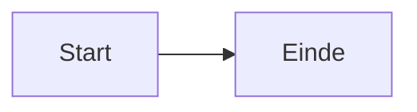

# MijnOverheid Zakelijk Site

In deze repository beheren we de website en content van [mijnoverheidzakelijk.nl](https://mijnoverheidzakelijk.nl).
De site wordt gegenereerd met [Hugo](https://gohugo.io/).

## Lokaal ontwikkelen

### Vereisten 

Installeer Hugo, Go, just, Node.js en uv:

```bash
# macOS
brew install hugo go just node uv
```

Of volg de installatie-instructies voor [Hugo](https://gohugo.io/installation/), [Go](https://go.dev/doc/install), [just](https://just.systems/man/en/), [Node.js](https://nodejs.org/) en [uv](https://docs.astral.sh/uv/). Hugo gebruikt Go om het theme op te halen (zie [Theme](#theme)). `uv` is nodig voor de Python-scripts die Mattermost-input voor de Weekly ophalen.

Installeer daarna de Node dependencies (eenmalig):

```bash
npm install
```

### Development server starten

```bash
just up
```

Dit rendert eerst de Mermaid-diagrammen als SVG en start daarna de Hugo development server. De site is dan beschikbaar op [http://localhost:1313/](http://localhost:1313/) (of de host zoals vermeld in de terminal).

Wil je dat diagrammen automatisch opnieuw worden gemaakt bij wijzigingen? Start dan in een aparte terminal:

```bash
just watch-mermaid
```

## Content toevoegen

### Weekly

Voeg een nieuwe weekly toe met:

```bash
hugo new content weekly/2026/2026-01-01.md
```

Of door een bestand in de juiste `content > weekly > jjjj` map te plaatsen.

Voor het ophalen van Mattermost-input als basis voor een Weekly, zie [`scripts/moza-weekly/README.md`](scripts/moza-weekly/README.md).

### Presentatie

Presentaties gebruiken de layout `nldd-deck`, met componenten uit het [NLDD Designsysteem](https://nederlandsedigitaledienst.github.io/design-system/). Ze openen in leesmodus; met <kbd>P</kbd> zet je de presentatiemodus aan, die dia's per klik opbouwt. De oudere MOZa Pulse-presentaties draaien nog op [Reveal.js](https://revealjs.com/).

Maak een nieuwe presentatie:

```bash
hugo new content --kind presentaties documenten/presentaties/naam-van-presentatie
```

#### Dia's

Elke dia is een `<section class="slide">` met een `aria-label`:

```html
<section class="slide" aria-roledescription="dia" aria-label="Korte naam">
  <p class="overline">Onderwerp</p>
  <h2 class="title">Titel van de dia</h2>
  <p class="lead">Eén of twee korte zinnen.</p>
</section>
```

De bouwstenen en de opbouw per klik staan in [`.claude/skills/nieuwe-presentatie/SKILL.md`](.claude/skills/nieuwe-presentatie/SKILL.md).

### Diagrammen

Gebruik een `mermaid` codeblock in Markdown voor diagrammen. Voeg altijd een `accTitle` en `accDescr` toe voor toegankelijkheid en als bestandsnaam voor de pre-gerenderde SVG:

````markdown

````

Diagrammen worden vooraf gerenderd als SVG (light + dark variant) door `scripts/render-mermaid.js`. De kleuren volgen automatisch het lichte of donkere thema via design tokens. Eigen kleuren in een diagram (bijvoorbeeld in `classDef`) schrijf je daarom als `var(--color-text)` in plaats van een hexcode; het renderscript vult per variant de juiste waarde in. Als de SVGs ontbreken, faalt de Hugo build met een foutmelding.

Render de SVGs opnieuw na het wijzigen van een diagram:

```bash
just render-mermaid
```

Zie [Mermaid](https://mermaid.js.org/) voor de volledige syntax.

### Kleuren

Kleuren, het lettertype en de iconen van de site komen uit het theme (zie [Theme](#theme)), dat ze uit het [NLDD Designsysteem](https://github.com/NederlandseDigitaleDienst/design-system) haalt. Moza's eigen bestandstype-icoon voor Markdown, de favicon en het touch-icon komen uit het npm-pakket `@nldd/design-system`. De gegenereerde bestanden staan in git; na een upgrade van het pakket schrijf je ze opnieuw weg:

```bash
just nldd
```

`npm test` bewaakt dat die bestanden bij het geïnstalleerde pakket passen. De bestandstype-iconen voor ODT en PDF blijven handgemaakt, NLDD heeft die niet.

Elke pagina krijgt een eigen afbeelding voor een gedeelde link, met de paginatitel erop. Die komen uit `just og-cards`, dat na de Hugo-build draait op het manifest `og.json` en per pagina een JPEG in `images/og/` schrijft. `just build` doet dat zelf al. De foto is de hero van de homepage.

## Theme

De site gebruikt [hugo-theme-rijksoverheid](https://github.com/RijksICTGilde/hugo-theme-rijksoverheid) als Hugo Module; de versie staat in `go.mod`. Bijwerken:

```bash
hugo mod get -u github.com/RijksICTGilde/hugo-theme-rijksoverheid
```

Dependabot doet dat ook (ecosysteem `gomod`); `tools.go` zorgt dat het theme daarvoor in `go.mod` blijft staan.

Kop, voet, pagina-opmaak, zoeken, de CSS-basis, iconen en het lettertype komen uit het theme. Een bestand met hetzelfde pad in deze repo gaat voor dat van het theme, dus kopieer er geen. Instellingen staan onder `params` in `hugo.yaml` (zoeken, afzender, `llms.secties`).

Deze bestanden houdt moza bewust zelf:

| Bestand | Waarom |
|---|---|
| `layouts/_partials/favicons.html` | Hook: moza's eigen favicons (`favicon.svg`, `touch-icon.png`). |
| `layouts/_partials/og-image.html` | Hook: een deelafbeelding per pagina, gemaakt door `just og-cards`. |
| `layouts/_partials/page-aside-extra.html` | Hook: het downloadblok (`downloads.html`) in de rechterkolom bij `download: true`. |
| `layouts/_partials/search-index-extra.html` | Hook: een zoekresultaat per dia van een presentatie. |
| `layouts/_partials/llm-instructies.html` | Hook: de instructies voor taalmodellen in `llms.txt` en `llms-full.txt`. |
| `layouts/_partials/rss-extra.html` | Hook: de RSS-feeds zonder de sprekersnotities van de presentaties. |
| `layouts/_partials/head.html` | Versie van het theme plus `print-kolombreedtes.html`: het theme heeft nog geen hook in `<head>`. |
| `layouts/_markup/render-table.html` | Versie van het theme plus de afdrukattributen `print-kolombreedtes` en `print-bijeen`. |
| `layouts/_partials/markdown-body.html` | Zet de shortcode `diagram-...` om in de plaat en laat de sprekersnotities weg, voor de Markdown-, ODT- en PDF-downloads. |
| `layouts/home.llmsfull.txt` | Versie van het theme plus `volledig: false` in `llms.secties`: de presentaties staan wel in `llms.txt`, maar hun HTML niet in `llms-full.txt`. |
| `static/favicon.ico`, `static/favicon-192x192.png` | Moza's eigen favicon, met dezelfde naam als die van het theme. |
| `assets/css/components/downloads.css`, `afdruk.css` | Opmaak van het downloadblok en afdrukregels voor wat alleen moza heeft. |

Alles wat verder in `layouts/`, `assets/` en `static/` staat, heeft het theme niet: presentaties, rapportages, downloads, weekly, actueel, diagrammen en de shortcodes van moza.

## Code kwaliteit

We gebruiken [Lefthook](https://github.com/evilmartians/lefthook) voor pre-commit checks. Dit controleert automatisch of de site correct bouwt en of er geen broken links zijn.

### Installatie

```bash
# macOS
brew install lefthook htmltest

# Activeer hooks in dit project
lefthook install
```

### Handmatig uitvoeren

```bash
just pre-commit
```

Of direct met Lefthook:

```bash
lefthook run pre-commit
```

## Bouwen

### Lokaal bouwen

```bash
just build
```

Dit rendert eerst de Mermaid-diagrammen als SVG en bouwt daarna de site met Hugo.

De gegenereerde site staat in de `public/` directory.

### Container bouwen

Voor development (image wordt getagd met branch naam):

```bash
just cbuild   # Bouw container
just crun     # Start op localhost:8080
just cstop    # Stop container
just cclean   # Verwijder image en cache
```

Voor productie met specifieke baseURL:

```bash
podman build --build-arg BASE_URL=https://mijnoverheidzakelijk.nl -t moza-site .
podman run -p 8080:8080 moza-site
```

De site is dan beschikbaar op [http://localhost:8080/](http://localhost:8080/).

## Projectstructuur

```
.
├── archetypes/          # Archetype templates voor nieuwe content
├── assets/              # CSS, JavaScript en image bestanden (worden o.a. geminimaliseerd door Hugo)
├── content/             # Markdown en HTML content
│   ├── onderwerpen/     # Onderwerpen pagina's
│   ├── documenten/      # Rapportages en presentaties
│   └── weekly/          # Weekly updates
├── layouts/             # Templates voor pagina's en componenten
│   ├── _partials/       # Herbruikbare template onderdelen
│   └── _shortcodes/     # Shortcodes, ofwel componenten, voor in content
├── scripts/             # Build scripts (Mermaid SVG rendering)
├── static/              # Statische bestanden (worden 1-op-1 gekopieerd)
├── .claude/             # Claude Code configuratie
├── .github/             # GitHub Actions workflows
├── go.mod               # Versie van het theme (Hugo Module)
├── hugo.yaml            # Hugo configuratie
├── justfile             # Command runner (just up, just build, etc.)
└── README.md            # Deze documentatie
```

## Credits

- Kleuren, font en iconen: [NLDD Designsysteem](https://github.com/NederlandseDigitaleDienst/design-system) (EUPL-1.2 licentie)
- Font: RijksSans is auteursrechtelijk beschermd door de Staat der Nederlanden en valt niet onder de licentie van deze repository. Het is uitsluitend bestemd voor publicaties van de Rijksoverheid of voor werk in opdracht van de Rijksoverheid; zie de [gebruiksvoorwaarden typografie](https://www.rijkshuisstijl.nl/basiselementen/typografie/gebruiksvoorwaarden-typografie). RijksSans komt uit het NLDD-pakket, zie daar [NOTICES.md](https://github.com/NederlandseDigitaleDienst/design-system/blob/main/NOTICES.md).
- Diagrammen: [Mermaid](https://mermaid.js.org/) (MIT licentie)
- Zoeken: [Fuse.js](https://www.fusejs.io/) (Apache 2.0 licentie)
