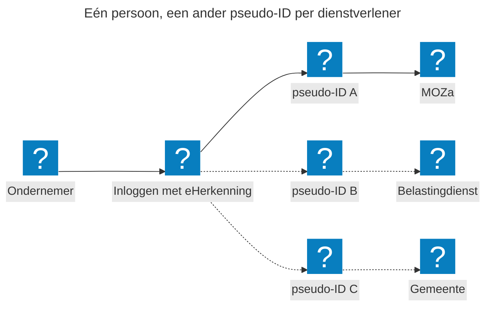

## eHerkenning in Nederland

eHerkenning is het zakelijke inlogmiddel voor ondernemers en organisaties. Wat DigiD is voor inwoners, is eHerkenning voor bedrijven. Je logt ermee in namens je onderneming, bijvoorbeeld bij de Belastingdienst, UWV, RVO of je gemeente. De [Wet digitale overheid](https://wetten.overheid.nl/BWBR0048156/) verplicht overheidsorganisaties om inloggen met eHerkenning te ondersteunen.

Ook MijnOverheid Zakelijk (MOZa) gaat inloggen met eHerkenning ondersteunen, naast DigiD en wallets. Daarom verkennen we hoe eHerkenning nu werkt en wat dat betekent voor MOZa. Ons doel: een ondernemer logt één keer in en ziet alles wat de overheid voor de onderneming heeft klaarstaan.

## Wat is eHerkenning?

eHerkenning is geen dienst van de overheid zelf. Je schaft het inlogmiddel aan bij een [erkende leverancier](https://www.eherkenning.nl/). De afspraken waar iedereen zich aan houdt, staan in het [Afsprakenstelsel Elektronische Toegangsdiensten](https://afsprakenstelsel.etoegang.nl/). Logius beheert dat afsprakenstelsel.

Drie dingen zijn belangrijk:

* **Persoonsgebonden.** Een inlogmiddel is van één persoon. Je mag het niet delen of overdragen. Iedere medewerker die namens de onderneming inlogt, heeft een eigen middel.
* **Machtigingen per dienst.** Zonder machtiging werkt eHerkenning niet. In een machtiging staat bij welke dienstverleners en voor welke diensten iemand namens de onderneming mag inloggen.
* **Betrouwbaarheidsniveaus.** Er zijn drie niveaus: EH2+, EH3 en EH4. De dienstverlener bepaalt welk niveau nodig is. De meeste dienstverleners vragen EH3.

### Zo hangt het samen

Een voorbeeld: een onderneming met een eigenaar en een medewerker. De medewerker logt in bij een dienstverlener om iets te regelen namens de onderneming.

Zo werkt het, stap voor stap:

1. **Aanschaffen.** De onderneming schaft bij een leverancier een inlogmiddel aan voor de medewerker.
2. **Machtigen.** De eigenaar legt bij de leverancier vast voor welke diensten de medewerker namens de onderneming mag inloggen.
3. **Inloggen.** De medewerker kiest bij de dienstverlener voor eHerkenning en logt in met het eigen middel.
4. **Verklaring.** De dienstverlener krijgt een verklaring terug. Daarin staat het KVK-nummer van de onderneming en een pseudo-ID van de medewerker. Ook staat erin dat de medewerker voor deze dienst gemachtigd is.
5. **Gebruiken.** De medewerker regelt de zaak namens de onderneming.

## eHerkenning en MOZa

### Eén inlog, één dienstverlener

Een pseudo-ID is een nummer dat de persoon aanduidt zonder dat de dienstverlener weet wie het is. eHerkenning maakt voor elke dienstverlener een ander pseudo-ID. Dit is zo ingericht om de privacy van de burger of ondernemer optimaal te borgen.

Maar het heeft ook een gevolg. Een inlog met eHerkenning geldt nu voor één dienstverlener. De Belastingdienst kent de medewerker onder een ander pseudo-ID dan de gemeente.

Zo lees je de plaat, van links naar rechts:

* **Ondernemer.** Een ondernemer of medewerker wil iets regelen namens de onderneming.
* **Inloggen met eHerkenning.** De ondernemer logt in met het eigen eHerkenning-middel.
* **MOZa (doorgetrokken lijn).** De ondernemer logt in bij MOZa. MOZa krijgt een eigen pseudo-ID van deze persoon: pseudo-ID A.
* **Belastingdienst en gemeente (stippellijnen).** Deze dienstverleners kennen dezelfde persoon onder een ander pseudo-ID: B en C. De stippellijn betekent: hier is de ondernemer nog niet ingelogd.

De letters A, B en C staan voor drie verschillende nummers voor één en dezelfde persoon. De Belastingdienst en de gemeente kunnen pseudo-ID A niet herkennen. Ze kunnen dus ook niet controleren of de persoon die bij MOZa is ingelogd, voor hun diensten gemachtigd is. Daarvoor moet de ondernemer bij hen apart inloggen.

### Wat betekent dit voor MOZa?

In MOZa wil je als ondernemer alle berichten van de overheid op één plek zien. Bijvoorbeeld via het [Federatief Berichtenstelsel](/onderwerpen/berichten/fbs/). Maar met de huidige eHerkenning kan MOZa nog niet de berichten van alle dienstverleners tonen. MOZa kan namelijk niet namens de ingelogde persoon aantonen dat die bij elke dienstverlener gemachtigd is.
### Wat we onderzoeken

* Hoe kan één inlog met eHerkenning in het MOZa-portaal gelden voor meerdere dienstverleners, zonder de privacy van de pseudo-ID's op te geven?
* Hoe neemt het MOZa-portaal de eHerkenning-machtigingen over, zodat berichten van een dienstverlener alleen worden getoond aan degene die hiervoor gemachtigd is?
* Hoe gebruiken ondernemers eHerkenning, DigiD en de business wallet of persoonlijke wallet straks naast elkaar?

## Wat we beproeven

We leren door te bouwen. In de [proeftuin](/onderwerpen/proeftuin/) ondersteunen we straks drie manieren van inloggen: DigiD, eHerkenning en wallets. De proeftuin heeft nog geen echte koppeling met eHerkenning. Je logt in met testgegevens.

## Samenwerking

We werken onder andere samen met:

* Logius
* het ministerie van Binnenlandse Zaken en Koninkrijksrelaties
* het ministerie van Economische Zaken

Daarnaast zoeken we contact met architecten van eHerkenning en met leveranciers. Ook halen we ervaringen op bij dienstverleners die gebruikmaken van eHerkenning als inlogmiddel.

## Meedoen

Heb je feedback op deze pagina? Of wil je meedenken over inloggen met eHerkenning in MOZa? Dat kan altijd: [neem contact met ons op!](/contact/)

## Meer info

* [eHerkenning.nl](https://www.eherkenning.nl/): informatie voor ondernemers en dienstverleners
* [Afsprakenstelsel Elektronische Toegangsdiensten](https://afsprakenstelsel.etoegang.nl/)
* [eHerkenning aanvragen op Ondernemersplein](https://ondernemersplein.overheid.nl/wetten-en-regels/eherkenning-aanvragen/)
* [Inloggen met DigiD op Mijn Belastingdienst Zakelijk vanaf januari 2027](https://www.belastingdienst.nl/wps/wcm/connect/nl/ondernemers/content/vanaf-januari-2027-inloggen-met-digid-op-mijn-belastingdienst-zakelijk-voor-meer-ondernemers)
* [Wallets: inloggen en machtigen](/onderwerpen/wallets/)
